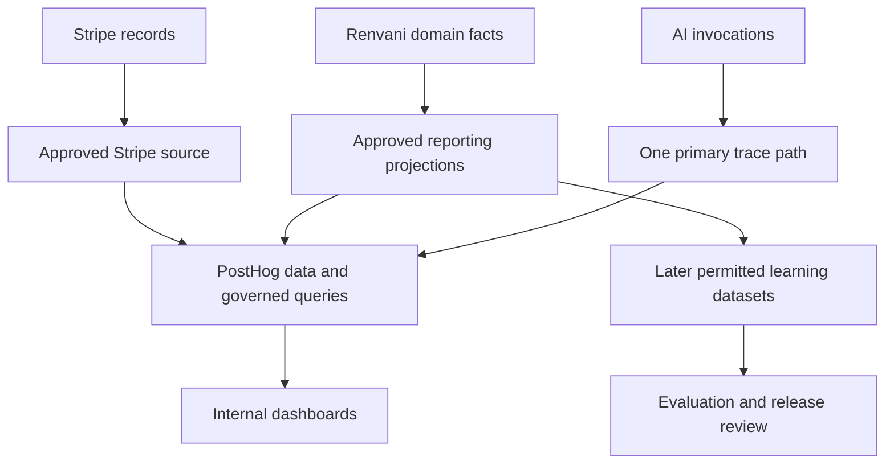

# 02: Platform Analytics Technical Specification and Codex/Cursor Sprints

Version 1.1 · November 7, 2026 · Twenty integration tickets / five logical sprints, plus three later learning tickets

## 1. Outcome, status, and companion documents

Integrate Stripe and selected Renvani data into PostHog to give the company a reliable internal view of financial performance, activation, observed workflow outcomes, AI usage, and data health. Configure the existing vendor interface. Keep authoritative business state, customer permissions, outcome meanings, and execution in Renvani.

This is a specification and implementation backlog. All PAI-C and PAI-L tickets are **Planned**, unassigned local planning IDs. They are not official FS numbers or evidence of deployed integrations. Source baseline: `dev` at `5e3e83eaaf52caa2b97707fbe67b0fc92f63cd58`. The baseline and merged/prepared work must be refreshed before code changes.

- [Build plan, source register, and decisions](../planning/PLATFORM-ANALYTICS-BUILD-PLAN-2026-11-07.md)
- [01: Preparation here](PLATFORM-ANALYTICS-01-CHATGPT-FOUNDATION-SPRINTS-2026-11-07.md)
- [Start here](../handoffs/PLATFORM-ANALYTICS-START-HERE-2026-11-07.md)
- [Ticket ledger](../planning/platform-analytics/ticket-ledger.v1.json)

**H01–H04 implementation input is now available:** [preparation checkpoint](../planning/platform-analytics/preparation/H01-H04-CHECKPOINT.md), versioned 24-metric catalog, seven logical record contracts and field/access/retention policy. H05–H08 remain planned. These detailed contracts elaborate the initial tables below; enable only the subset whose definitions, fields and runtime evidence are accepted. C02 must coordinate a versioned RCI adapter because current v1 money schemas assume two decimals and the PA metric IDs are not registered. Direct Stripe ingestion remains conditional on the full exported field policy; use the sanitized-export alternative if the native payload cannot meet it.

## 2. Architecture and responsibilities



### Financial and operational authority

Stripe remains authoritative for its provider objects; Renvani domain services own application business state. Reconciled reporting views explain their relationship. PostHog is an analytical copy and presentation surface, not an authority for charging, financial corrections, job completion, or permissions. Projection rebuilds are reproducible reads/derived writes and never trigger business actions.

Use the direct PostHog Stripe source first if verified account/resource coverage and exported fields fit the approved policy. The official connector documents different mutation behavior by sync mode and resource; actual source-table refresh is not necessarily instantaneous. Select and test the mode per resource. Do not infer complete Connect account coverage from a platform connection. [Stripe connector reference](https://posthog.com/docs/data-pipelines/sources/stripe).

Use a selected Postgres reporting dataset for application facts. Prefer scheduled copies for joins with product events and dashboards. A direct live database query is a separate capability and is not required for the internal dashboard. Do not add replication or CDC access without a demonstrated requirement and reviewed privileges. [Postgres connector reference](https://posthog.com/docs/data-pipelines/sources/postgres).

### AI path

C01 chooses one primary trace path based on actual implementation, compatibility, privacy, and cost. Prefer completing existing Langfuse work when it is useful; otherwise select PostHog AI instrumentation behind Renvani's adapter boundary. When both tools are used, designate one capture authority and one imported analytical representation. A stable invocation/attempt ID prevents double counting. Native Langfuse ingestion is optional, not permission to export all observations or prompt content. [Langfuse source](https://posthog.com/docs/data-pipelines/sources/langfuse) and [AI privacy controls](https://posthog.com/docs/ai-observability/privacy-mode).

### Existing code and program reuse

Reuse `packages/types/src/connected-intelligence/v1/`, deterministic foundation math, current domain readers, existing activity events/outbox, BullMQ processing/recovery, company authorization, and #445 workflow services. Reconcile FS-43/#142 before creating observability code. This work extends the existing RCI C01/C02/C04/C05/C09/C10 plan for internal company reporting; it does not replace that plan or add a sixth customer product.

Reuse requires a compatibility check: current RCI strict metric/money contracts do not accept all proposed PA definitions, variable minor-unit exponents or AI micro-cost precision unchanged. H02/H03 and decision D13 document the exact extension boundary. Existing activity-list caps, queued receipts and event names also cannot be used as proof of complete cohorts, delivery or collection without the specified adapters and source evidence.

## 3. Logical data contracts

The following are required logical interfaces. They do not mandate one physical table per interface or a second database. A view, existing contract, or rebuildable projection may satisfy each. Persisted schema changes remain in `packages/db/src/schema.ts`; SQL reporting views are migration-backed derived interfaces with documented grants and lineage.

| Contract | Grain and identity | Minimum fields | Authority and constraints |
|---|---|---|---|
| `rpt_company_identity_v1` | One effective company/provider mapping | `company_id`, environment, provider/account/mode, mapping role, provider object ID, valid-from/to, plan/version, permitted company cohort attributes | Source company identity plus verified provider references; ambiguous matches are exceptions |
| `rpt_financial_posting_v1` | One classified financial component/posting or reversal | Account-scoped source key, company, component, currency, exact signed amount, occurrence/update time, charge/invoice/payment/fee/refund references, status, pricing evidence/version, reconciliation state | Derived from actual Stripe objects plus trusted application classification; no estimated fee substitution |
| `rpt_workflow_opportunity_v1` | One canonical eligible opportunity snapshot | Company, opportunity/workflow IDs, eligibility/policy version, eligibility time, pre-decision features, selected/unselected reason, source history provenance, maturity window | Includes every eligible opportunity, not only recommended or successful ones |
| `rpt_workflow_fact_v1` | One lifecycle observation | Opportunity, recommendation/action/attempt IDs, fact type/state, source references, source time, job/invoice/payment references, evidence version | Approval, execution, acknowledgement, delivery, response, booking, completion, collection are separate |
| `rpt_outcome_allocation_v1` | One source financial component allocation | Source payment/refund component, company, opportunity/job/invoice references, allocated exact amount, basis/version | Preserve source company, currency, and sign; signed allocations plus explicit remainder equal the source component; allocated magnitudes are bounded; product assists are non-additive |
| `rpt_usage_cost_v1` | One actual invocation attempt or source expense allocation | Usage ID, company, trace/workflow/action IDs, provider/model/version, quantities, latency/outcome, currency, exact cost, cost basis, price/allocation version, completeness | Includes all actual attempts, including zero-cost or unknown-billing attempts; billed failures and retries retain cost; alternative estimates are not additive |
| `rpt_source_health_v1` | One source/run/check result | Source and configuration version, run ID, cutoff, start/end/last success, lag, coverage, mismatch/unmapped counts, status, correction checkpoint | Explains freshness and reliability; it is not operational payment state |

### Shared metadata

Every contract includes schema version, source system/reference, source occurrence/update time, ingested time, correction/revision metadata, and provenance sufficient to reproduce the result. Use UTC storage with an explicit reporting timezone. Preserve company-local periods for company metrics and use the selected internal reporting timezone for platform metrics. DST and period boundaries require tests.

Money uses the existing exact-decimal/string conventions. Where a provider supplies integer minor units, retain the currency exponent and exact units. Do not assume every currency has two decimals. AI micro-costs retain sufficient decimal precision and a rounding/version policy. Round for display, not repeatedly during aggregation. Currencies stay separate until an explicit versioned conversion policy is introduced.

### Identity and duplicate rules

- Canonical company identity is Renvani's server-verified `companyId`; a browser field or email cannot establish ownership.
- Provider keys include provider, environment/live-test mode, account scope, resource type, and object ID. A bare provider ID is insufficient.
- Keep mapping validity when accounts, plans, or ownership references change. Do not rewrite historical source identity silently.
- A business event has a stable event ID; a provider object has a stable source key plus accepted update/revision state. Duplicate source deliveries do not create new financial facts.
- AI `invocation_id` identifies the logical call and `attempt_id` identifies each actual attempt, independently of whether its cost is known or billable. An imported copy is deduplicated; a real retry remains usage and retains any evidenced cost.
- Payments may span invoices or opportunities. Allocation records preserve the source component's company, currency, and sign. Signed allocations plus an explicit unallocated remainder equal the exact signed source amount; allocated magnitudes cannot exceed its magnitude. Corrections preserve lineage and apply once. A nonzero remainder remains visible and prevents a complete-allocation claim. Never rely on a many-to-many join followed by a sum.

### Event envelope and lifecycle

Adopt existing event types when their meaning fits. H03 specifies additions only for missing facts. A reporting event envelope requires `event_id`, `schema_version`, `company_id`, `event_type`, `occurred_at`, `ingested_at`, `source_ref`, and applicable `opportunity_id`, `workflow_id`, `action_id`, `attempt_id`, `release_version`, and `policy_version`. A quality/coverage state accompanies incomplete evidence.

Record the lifecycle as observations, not one destructive status field: eligible; selected or unselected; proposed; approved/declined; execution attempted/succeeded/failed; provider accepted/delivered/unknown; response; booked; work completed; principal collected; refund/correction. Some workflows omit stages; that omission must be explicit. A provider acknowledgement does not prove delivery, and delivery does not prove customer or financial success.

## 4. Financial meaning and pricing reconciliation

The current adapter distinguishes Renvani platform billing with `billingKind: platform_mvp`. Merchant maintenance subscriptions and VIP memberships coexist. Classification must inspect trusted account/product/metadata and local references rather than aggregate all Stripe subscriptions. [Current adapter](https://github.com/SimonShaun2/Renvani/blob/5e3e83eaaf52caa2b97707fbe67b0fc92f63cd58/apps/api/src/lib/stripe.ts).

| Component | Included meaning | Explicit exclusions and adjustments |
|---|---|---|
| Platform subscription receipts | Collected Renvani subscription principal allocated to the accepted period | Separate taxes, credits, refunds, one-time items, and merchant memberships |
| Platform MRR | Monthly normalized recurring Renvani subscription contract value under the adopted definition | Exclude transaction fees, merchant subscriptions, taxes, nonrecurring items, and unsupported billing intervals |
| Platform application fees | Actual fee postings collected for the platform | Actual fee-refund/adjustment postings reduce the appropriate component; do not compute revenue as volume times a headline rate |
| Merchant collections | Collected service principal attributable to the merchant | Exclude Renvani fees/tax/tips as defined; preserve partial refunds and payment allocation |
| Merchant recurring payments | Homeowner/customer maintenance or VIP membership payments | Never include as Renvani subscription MRR |
| Transfers and payouts | Movement or settlement of already classified funds | Do not create revenue a second time |
| Processor and other service costs | Attributable provider expense under the selected cost definition | Do not confuse processor charges with Renvani application fees; avoid counting the same charge as both direct and allocated cost |

MRR v1 is a management metric, not a cash or accounting-recognition claim. H02 freezes the supported monthly/annual plans, quantity, recurring-discount, trial, proration, cancellation, and delinquency treatment. Adopt Stripe's selected definition when it fits the platform-only population and document any deliberate difference. Unknown or unsupported subscription types remain exceptions. Do not hand-wave reconciliation by comparing different definitions.

Cash, settlement, and business completion have different timestamps. A refund posted in a later period appears in the appropriate refund/posting period and may also update a separately labeled cumulative-net view. Do not overwrite historical periods with current object totals without a documented restatement basis. Pending settlement is not necessarily missing payment.

**Pricing authority:** the founder's current direction is 5%. The inspected `computeCheckoutFees` path uses 200 basis points on applicable plans, with Flat exempt; an older helper is deprecated. This is an unresolved policy/implementation alignment issue. Preserve the founder direction and report historical actual fees. The analytics initiative does not change checkout behavior, select a new rate, or claim that the live account has been audited. [Source](https://github.com/SimonShaun2/Renvani/blob/5e3e83eaaf52caa2b97707fbe67b0fc92f63cd58/packages/config/src/stripe-pricing.ts).

## 5. Initial metric catalog

These are proposed v1 definitions for H02 to freeze against actual source coverage. IDs below are local analytics metric IDs and must be mapped to compatible existing RCI definitions where their meanings are identical. They are not a second customer-financial metric framework.

| ID | Metric and calculation basis | Grain / limitation | Dashboard |
|---|---|---|---|
| PA-M01 | Platform subscription net receipts: classified collected principal less applicable refund postings | Company/currency/posting period; cash basis | Economics |
| PA-M02 | Platform MRR: supported recurring platform items normalized monthly under frozen H02 definition | Company/currency/as-of snapshot; distinct from receipts | Economics |
| PA-M03 | Net platform fees: actual fee postings less actual fee refunds/adjustments | Company/currency/posting period; no fixed-rate multiplication | Economics |
| PA-M04 | Merchant service principal collected, net of principal refunds | Company/currency/collection period; context, not Renvani revenue | Economics/outcomes |
| PA-M05 | Refunds and financial adjustments by component | Company/currency/posting period; distinguish principal and fee reversals | Economics |
| PA-M06 | Eligible onboarded companies | Fixed company cohort with environment, readiness, and exclusions | Activation |
| PA-M07 | Companies reaching first accepted workflow value | Distinct eligible company; named backend-confirmed milestone | Activation |
| PA-M08 | Time to first value from agreed service-ready timestamp | Completed observations plus explicit still-unactivated count | Activation |
| PA-M09 | Repeated successful workflow use within defined company cohort/window | Company-level continuation; not employee login retention | Activation |
| PA-M10 | Eligible recovery opportunities | Distinct canonical opportunity from pre-decision snapshot | Outcomes |
| PA-M11 | Executed attempts, failures, declines, and unselected opportunities | Preserve logical action versus attempt counts | Outcomes |
| PA-M12 | Observed delivery/response/booking conversion by mature eligible cohort | Defined maturity window; pending denominator handling explicit | Outcomes |
| PA-M13 | Linked completed jobs | Unique accepted allocation/grain; avoid duplicate assists | Outcomes |
| PA-M14 | Linked collected service principal for the recovery cohort | Source-reconciled allocations; associated outcome, not causal lift | Outcomes |
| PA-M15 | AI invocation attempts and failure rate | Count actual attempts; missing traces reported as coverage gaps | AI/data health |
| PA-M16 | AI latency distribution by workflow/model/version | Comparable instrumented calls; publish coverage | AI/data health |
| PA-M17 | AI cost by company/workflow/model with cost basis | Estimated/provider-reported/invoice-allocated amounts are distinct | Economics/AI |
| PA-M18 | Cost per verified workflow outcome | Defined eligible-cohort costs divided by mature verified outcomes; no denominator means unavailable | Economics |
| PA-M19 | Attributable cost to serve and component coverage | Direct and shared costs with allocation/version; unknown is not zero | Economics |
| PA-M20 | Management contribution under explicit cash/cost basis | Platform receipts plus fees less adopted costs; partial coverage labeled | Economics |
| PA-M21 | Unmapped/ambiguous source identity counts and value | Per source/account/mode; quarantined from inappropriate totals | Data health |
| PA-M22 | Reconciliation exceptions by count and exact component amount | Like-for-like currency, cutoff, basis, and account | Data health |
| PA-M23 | Source freshness and export coverage | Last successful cutoff, lag, missing expected records | Data health |
| PA-M24 | Outcome link completeness and pending maturity | Eligible cohort; distinguish missing link from an outcome still pending | Outcomes/data health |

Every catalog entry also requires version, authoritative readers, exact formula, filters, unit, timezone, exclusions, accepted cutoff/lag, completeness rule, drill-through, owner function, and tests. No incremental-lift metric is enabled in v1. Introduce one only through L03 with a registered experiment and mature outcome evidence.

For activation, a reasonable first milestone is a backend-confirmed recovery booking linked to an eligible estimate; H02 must confirm it with product ownership and source availability. A sent message alone is insufficient. Completed and paid outcomes remain separate later milestones. The maturity window is a versioned workflow policy, not a universal number invented by the dashboard.

## 6. Dashboard and query contract

| Dashboard | Required first cards | Optional later cards | Decision supported |
|---|---|---|---|
| Economics | M01–M05, M21/M22 quality context | M17–M20 after cost acceptance | Explain Renvani receipts/fees and investigate financial gaps |
| Activation | M06–M09 with readiness/missing-event context | Supported trade/size/location breakdowns | Prioritize onboarding and assess continued value |
| Outcomes | M10–M14, M24 | Experimental lift only after L03 | Inspect where existing recovery work succeeds, fails, or remains pending |
| AI/data health | M21–M24; source failures and lag | M15–M17 when AI capture is accepted | Investigate unreliable or costly workflows and incomplete reporting |

Each card records metric/version, data/query version, period/timezone, currency, company/cohort/environment scope, source cutoff, quality/completeness, reconciliation state, and permitted drill-through. Global filters cannot silently change a denominator or include test/imported history. Zero is a real observed zero; no eligible population, source unavailable, stale source, and partial coverage have different displays.

### Logical query examples

The following are contract illustrations, not production-ready HogQL or verified source-table names. C06/C13 bind actual schemas and compare fixture results before enabling them.

```sql
-- Signed postings; fee refunds are separate negative postings.
SELECT company_id, currency, SUM(amount_minor) AS net_platform_fee_minor
FROM rpt_financial_posting_v1
WHERE financial_component IN ('platform_application_fee', 'platform_application_fee_refund')
  AND environment = :environment
  AND occurred_at >= :period_start_utc
  AND occurred_at < :period_end_utc
  AND reconciliation_state = 'verified'
GROUP BY company_id, currency;
```

An adjacent exception card reports excluded counts/amounts. Filtering to verified data does not justify a claim of complete coverage.

```sql
-- One row per eligible company in this logical view, including no-success cases.
SELECT cohort_id,
       COUNT(*) AS eligible_companies,
       SUM(CASE WHEN first_value_at IS NOT NULL THEN 1 ELSE 0 END) AS activated_companies
FROM rpt_company_activation_cohort_v1
WHERE definition_version = :definition_version
GROUP BY cohort_id;
```

The implementation may use PostHog groups or governed SQL over company identifiers. Groups support company analysis but do not enforce tenant permissions. Confirm the paid group-analytics entitlement and its event-billing impact before enabling it. [Group analytics reference](https://posthog.com/docs/product-analytics/group-analytics).

## 7. Access, data minimization, and retention

- The internal workspace is for authorized Renvani staff. Customer users do not receive access to the cross-company project. A company filter or group ID is not an authorization boundary.
- Separate vendor administrators/maintainers from viewers. If the selected plan cannot enforce a required limited staff scope, use an approved aggregate dataset/project or existing authorized Renvani tools; do not grant broad access and rely on saved filters.
- The database connector uses a dedicated reviewed read-only role over the approved reporting interface. Do not disable operational RLS or grant unrestricted domain access to make analytics convenient. Cross-company reporting is an explicit internal export capability, independently tested.
- Inspect native connector columns and actual sample payloads before real transfer. Stripe resource permissions and table selection do not necessarily remove nested personal data. If the field allowlist cannot be enforced, exclude that resource or implement a reviewed sanitized export boundary. Verify account/product eligibility and purpose; do not assume backend access grants external-processing permission.
- Default exports omit secrets, raw message/prompt/output content, sensitive notes, end-customer addresses/contact details, payroll, and payment-method details. Minimal company labels/cohort attributes require an explicit reporting purpose. IDs remain potentially identifying and are access-controlled.
- AI privacy mode is a helpful control, not a substitute for inspecting payloads. Local deterministic checks can emit scores without exporting raw content. Any content-based evaluation needs separately permitted, minimized inputs.
- Select provider region and retention before real ingestion; define deletion/withdrawal/correction propagation through copied and derived records. Preserve required financial audit retention under a documented policy. Do not promise that model training can be automatically undone by deleting a dashboard row.
- No PostHog workflow, webhook destination, or experimental flag can bypass Renvani's existing action authority. Reporting event replay must never execute customer actions.

## 8. Freshness, reconciliation, reliability, and cost

### Proposed pilot service targets

Billing/application source cutoff within 60 minutes, AI summary cutoff within 60 minutes, and daily financial/cost reconciliation available by 09:00 America/Chicago are proposed pilot targets. C01/H07 validate their feasibility and record the chosen source schedule, provider limits, dataset size, and budget. Native connector marketing language is not evidence that the target is met.

Reconciliation compares the same account/mode, financial component, currency, time basis, and cutoff. Verify object-level samples and aggregate totals. Closed financial samples match exact minor units; unknown or pending differences remain visible exceptions. A grand total can agree while classification is wrong, so component comparisons are mandatory.

Critical business facts come from authoritative records/projections, not sampled browser analytics. Sampling is acceptable for selected diagnostics only when coverage is explicit. Analytics capture must not add a required external HTTP call to payment, booking, or job-completion paths. Use existing durable work where correctness requires it; a best-effort telemetry loss must be counted as a coverage gap.

Backfill jobs use stable checkpoints, bounded batches, measured source load, retries, and existing recovery tools. Duplicate and late updates must be safe. Outages mark sources stale, preserve last-good data with its cutoff, and prevent affected verified claims. Pausing reporting must leave operational payment webhooks and application state changes functioning.

### Cost model and vendor controls

Estimate monthly product events, source rows/updates, trace events, retention/storage, and group entitlement separately. Measure a representative bounded sample before widening collection. Set available vendor caps/alerts and record what happens at a cap: missing analytics must be visible and must not block customer operations.

The current vendor pricing includes free allowances and separately charged features; do not budget the proposed complete system as free. Refresh actual account pricing and entitlement during C01. [PostHog pricing](https://posthog.com/pricing).

AI price-derived cost is an estimate unless confirmed against the relevant provider expense basis. Model/provider rates, cache treatment, retries, and rounding have versions. Later provider-bill allocation reconciles a pool; it must not be added again to the corresponding estimated direct usage. Support and infrastructure costs require explicit allocation and coverage. Do not label partial contribution as full company or customer profit.

## 9. Acceptance matrix

These are planned acceptance cases, not executed tests. H05 creates synthetic expected results; C tickets execute the appropriate real integration checks. The release manifest lists which cases are enabled, passed, blocked, or not applicable with reasons.

| Case | Scenario | Required result |
|---|---|---|
| AT01 | Two companies, shared staff, workspace switch | Correct company/group mapping; no merge or duplicate activation |
| AT02 | Platform subscription and merchant membership coexist | Only platform classification enters Renvani MRR/receipts |
| AT03 | Merchant principal, fee, transfer, and payout | Components remain distinct; money movements do not create extra revenue |
| AT04 | Actual fee differs from headline rate; Flat/no-fee case | Actual source fee wins; no blanket-rate imputation |
| AT05 | Partial merchant principal refund | Principal and net merchant collection update; fee not assumed refunded |
| AT06 | Actual fee refund occurs later | Fee reversal applies once to the correct component/time basis |
| AT07 | Unpaid/failed invoice or retry | No collected-cash claim from invoice face value or failed attempt |
| AT08 | Monthly/annual, discount, trial, cancellation, delinquency | MRR matches the frozen supported definition; cash remains separate |
| AT09 | Same object identifier across account/mode scopes | Keys cannot collide; test records do not contaminate live totals |
| AT10 | Duplicate delivery and retry | Financial facts and outcomes are not double-counted |
| AT11 | Late or out-of-order source update | Correct accepted state/posting history and recomputed reporting window |
| AT12 | Historical import/backfill/resume | Baseline provenance retained; no new activation or Renvani-caused revenue claim |
| AT13 | Eligible unselected, declined, failed, pending opportunities | Fixed cohort preserved; maturity handling explicit |
| AT14 | Approved action with execution/delivery uncertainty | Distinct lifecycle facts; no false execution or delivery success |
| AT15 | Booked job, completed job, and collected payment differ | Separate counts/amounts with authoritative links |
| AT16 | Payment and partial refund split across two opportunities, remainder, corrected allocation | Preserve company/currency/sign; signed conservation with visible remainder, bounded magnitudes, and once-only correction lineage |
| AT17 | Mixed currency, minor-unit exponent, decimal edge | No implicit FX or floating-point drift; exact money handling |
| AT18 | Missing cost/usage or missing source | Unknown/partial state; no zero-cost or complete-margin claim |
| AT19 | Trace imported twice; real retry; shared expense pool | Copies deduplicated, billed retry retained, allocation not doubled |
| AT20 | Customer/vendor/database/support role misuse | Required negative access tests deny unauthorized data/actions |
| AT21 | Sensitive fields nested in connector/AI payload | Excluded or explicitly permitted before real transfer; inspection evidence |
| AT22 | Correction, deletion, withdrawal, and retention exception | Copies and derived data follow the documented policy |
| AT23 | Connector/queue/provider outage or expired credential | Visible stale/failure state, bounded retry, recoverable source ingestion |
| AT24 | Analytics disabled or reporting replayed | Payments, customer messages, bookings, and jobs remain unaffected |
| AT25 | Application or vendor query/configuration changes | Evidence identifies versions; affected acceptance is refreshed |
| AT26 | Dashboard filters/empty/stale/partial states | Matches source definition and denominator; no hidden missing data |
| AT27 | Instrumented call succeeds, fails, or loses telemetry | Usage coverage and failures are measured; output quality remains separate |
| AT28 | Backfill/source load, event volume, group add-on, cap | Measured cost/load within accepted budget; cap behavior is visible |
| AT29 | Pause, rollback, resume, and controlled revocation | Reporting recovers safely and does not alter business authority |
| AT30 | Later dataset contains future facts or overlapping held-out companies | Leakage detected; candidate evaluation blocked |
| AT31 | Reporting permission exists but training permission does not | Record/field excluded from the learning dataset |
| AT32 | Correlation or AI output score presented as business lift | Claim refused until an accepted business experiment supports it |

### Requirement coverage

| Requirement | Owning tickets | Acceptance cases |
|---|---|---|
| PA-R01: Integrate the internal reporting hub | PAI-C01, PAI-C04, PAI-C05, PAI-C13, PAI-C14, PAI-C15, PAI-C16 | AT25, AT26 |
| PA-R02: Stable company and provider identity | PAI-H03, PAI-C02 | AT01, AT09 |
| PA-R03: Separate platform and merchant finances | PAI-H02, PAI-C06, PAI-C08 | AT02, AT03, AT04, AT05, AT06, AT07, AT08 |
| PA-R04: Safe synchronization, correction, and replay | PAI-C04, PAI-C05, PAI-C07 | AT10, AT11, AT12, AT22, AT23, AT24 |
| PA-R05: Approved fields and actual access controls | PAI-H04, PAI-C01, PAI-C03, PAI-C05, PAI-C17 | AT20, AT21, AT22 |
| PA-R06: Complete opportunity and outcome evidence | PAI-H03, PAI-C09, PAI-C15 | AT13, AT14, AT15, AT16 |
| PA-R07: Exact money and financial reconciliation | PAI-H02, PAI-H05, PAI-C06, PAI-C08 | AT03, AT05, AT06, AT17 |
| PA-R08: Honest AI and cost-to-serve coverage | PAI-C11, PAI-C12, PAI-C16 | AT18, AT19, AT27, AT28 |
| PA-R09: Company activation and repeated value | PAI-C10, PAI-C14 | AT01, AT12, AT26 |
| PA-R10: Visible freshness, completeness, and exceptions | PAI-H06, PAI-C08, PAI-C16 | AT18, AT23, AT26 |
| PA-R11: Independent accepted and reversible release | PAI-H08, PAI-C17, PAI-C18, PAI-C19 | AT20, AT23, AT24, AT25, AT28, AT29 |
| PA-R12: Separate permitted learning and causal evidence | PAI-C20, PAI-L01, PAI-L02, PAI-L03 | AT30, AT31, AT32 |
| PA-R13: Reuse current RCI, workflow, and FS-43 work | PAI-H01, PAI-C01, PAI-C03, PAI-C09, PAI-C10 | AT25 |
| PA-R14: Configuration and preparation traceability | PAI-H05, PAI-H06, PAI-H07, PAI-H08, PAI-C17 | AT25, AT26 |

## 10. Sprints and file boundaries

| Sprint | Tickets | Exit |
|---|---|---|
| C0: Runtime boundaries and reporting access | C01–C04 | Verified identity, approved export boundary, and selected Postgres source |
| C1: Financial ingestion and reconciliation | C05–C08 | Platform billing/fee measures reconcile without merchant-revenue mixing |
| C2: Business outcomes and AI/service cost | C09–C12 | One existing lifecycle plus attributable usage and explicit cost coverage |
| C3: Internal dashboards | C13–C16 | Native dashboards with governed definitions, quality, and permitted detail |
| C4: Acceptance, pilot, operations | C17–C20 | Enabled scope accepted and operable; learning-readiness design is an optional follow-on |
| L1: Later controlled learning | L01–L03 | Permitted dataset, baseline/shadow evaluation, separately authorized experiment/release |

Dependencies govern execution; sprint labels are not barriers. Pull C10 activation forward after C02/H02/H03 when its selected milestone already has authoritative records, and configure C13/C14 as their inputs clear. An early M1 release may exclude C09/C11/C12/C15/C20 and all L tickets. Billing and data-health reporting can release alone; first-value activation is included only when the approved milestone is already supported by authoritative records. Otherwise the affected activation cards remain unavailable until the required lifecycle evidence exists. C17–C19 then cover exactly the enabled scope. C16 can provide data-health cards before AI panels are enabled.

Proposed code boundaries, subject to C01 ownership review: shared compatible schemas in `packages/types`; validated configuration/flags in `packages/config`; any canonical persisted schema in `packages/db/src/schema.ts`; projection/classification services under `apps/api/src/services`; existing webhook domain handlers only where a missing authoritative fact must be emitted; background export/reconciliation through `apps/worker` and existing `packages/jobs`; AI adapters under `packages/ai`. Default dashboard work changes vendor configuration and repository manifests, not `apps/web` UI.

Use a docs/configuration manifest for vendor project/source/dashboard/query IDs, source schema versions, allowlist, metric versions, checksum, code commit, and validation evidence. Never commit API keys, session cookies, connection strings, raw customer records, or real prompt content. Exact reviewed code alone cannot certify a subsequently edited dashboard query.

## 11. Full Codex/Cursor ticket cards

### PAI-C01: Reconcile implementation ownership and integration decisions

**Sprint:** C0 · **Status:** Planned · **Assignment:** Unassigned

**Objective:** Resolve the current source, existing FS work, vendor configuration, and implementation boundaries for the first slice.

**Dependencies:** PAI-H01, PAI-H04, PAI-H07.

**Scope and implementation boundary:** Inspect current dev and preserved FS-43 work; confirm the actual charge design, source scopes, provider entitlements, and export policy. Record the applicable owner functions and branch/file split. Compare completing Langfuse versus native PostHog capture on a bounded sample.

**Deliverables:**

- Implementation preflight and FS/RCI crosswalk
- Account/region/mode/source inventory
- One primary AI trace-path decision
- Versioned configuration and budget proposal

**Acceptance criteria:**

1. Current commit, existing implementations, overlap, ownership, and first PR scope are recorded; no completed foundation is rebuilt.
2. One Stripe ingestion path and one primary AI trace path are selected with account/mode coverage and costs documented.
3. Native source field coverage, region/retention/access, resource scopes, and group-analytics entitlement are resolved before relevant real data transfer.
4. Founder pricing direction versus source discrepancy is routed separately; no checkout or fee-rate mutation is included.

**Verification evidence:** Source/configuration review; Credential-free setup and rollback review.

### PAI-C02: Company and provider identity mapping

**Sprint:** C0 · **Status:** Planned · **Assignment:** Unassigned

**Objective:** Link every included source record to the correct company without guessing or crossing account environments.

**Dependencies:** PAI-C01, PAI-H03.

**Scope and implementation boundary:** Reuse company billing and connected-account IDs with validity history where needed. Include provider account, environment, mode, resource type, and object ID. Server-authorized company context governs business events; a browser property cannot establish financial ownership.

**Deliverables:**

- Versioned identity adapter/projection
- Unmatched/ambiguous mapping report
- Company-group configuration manifest

**Acceptance criteria:**

1. Platform and merchant sample records map correctly across two companies, account changes, and live/test environments.
2. Conflicting or missing identity is quarantined with counts and source references, without email-based fallback or assignment to a default company.
3. Shared staff and workspace switches do not merge companies; repeated events preserve stable identity.
4. Mappings and corrections are auditable; group setup is treated as analysis configuration, not tenant access enforcement.

**Verification evidence:** AT01, AT09, AT20; Integration tests for identity corrections and tenant-context changes.

### PAI-C03: Approved reporting projections and database access

**Sprint:** C0 · **Status:** Planned · **Assignment:** Unassigned

**Objective:** Expose only the data needed for internal analysis through a constrained read-only boundary.

**Dependencies:** PAI-C02, PAI-H02, PAI-H03, PAI-H04.

**Scope and implementation boundary:** Implement logical contracts using existing views or rebuildable projections. Changes to persisted domain schema remain in packages/db/src/schema.ts; migration-backed SQL views are derived reporting interfaces. Reuse existing events/outbox/queues and source calculations.

**Deliverables:**

- Minimal reporting views/projections and migrations if required
- Dedicated integration role/grants
- Export-field manifest
- Projection rebuild procedure

**Acceptance criteria:**

1. The actual integration role cannot write, read disallowed operational objects, or infer unapproved fields; do not rely on owner/BYPASSRLS behavior.
2. Allowed projections contain schema/definition/source versions, exact money, occurrence/update times, and explicit quality states.
3. Rebuilding a projection reproduces authoritative results and never calls customer-send, payment, booking, or job-write actions.
4. Cross-company aggregation is a separately authorized internal export path, not a weakened customer reader; required migrations and rollback are reviewed.

**Verification evidence:** AT17, AT20, AT21, AT24; Real database role/RLS/grant tests; Projection parity and replay tests.

### PAI-C04: Postgres source configuration and update coverage

**Sprint:** C0 · **Status:** Planned · **Assignment:** Unassigned

**Objective:** Synchronize the selected reporting contracts into PostHog with visible freshness and complete update behavior.

**Dependencies:** PAI-C03, PAI-H07.

**Scope and implementation boundary:** Prefer scheduled sync of minimal reporting objects for joined dashboards. Choose full, incremental, or CDC based on mutation/deletion requirements and measured source load. CDC/replication rights require separate justification; avoid unnecessary production broad access.

**Deliverables:**

- Selected Postgres source configuration
- Source/query-mode and schema manifest
- Backfill/update/correction evidence
- Source-load measurements

**Acceptance criteria:**

1. Initial backfill and subsequent changes preserve unique records and expected values; the declared mode supports the required correction/deletion policy.
2. The connector sees only approved objects and fields; copied data has separate vendor access and retention controls.
3. Last successful sync, source cutoff, freshness target, backlog, and failure state are available; stale data is not presented as current.
4. Polling/backfill load is measured against the agreed baseline and budget; pausing the source does not affect application transactions.

**Verification evidence:** AT11, AT12, AT22, AT23, AT28; Real source backfill and update/correction tests.

### PAI-C05: Stripe source configuration and resource coverage

**Sprint:** C1 · **Status:** Planned · **Assignment:** Unassigned

**Objective:** Import required financial objects using the native connector where its verified scope and field policy fit.

**Dependencies:** PAI-C01, PAI-H07.

**Scope and implementation boundary:** Configure required subscriptions, invoice/payment allocation, charges, application fees, fee refunds, merchant refunds, and balances/expenses as supported. Inspect actual payload fields before real transfer. If minimization or Connect coverage fails, propose the smallest filtered reporting-export alternative rather than granting broader access.

**Deliverables:**

- Stripe account/mode/resource manifest
- Restricted credential and webhook configuration record
- Source freshness and coverage checks

**Acceptance criteria:**

1. Actual account and charge design are verified; one platform source is not assumed to cover every connected account.
2. Approved resources and fields are available in the right environment; operational payment webhooks remain independent and unchanged.
3. Updates to existing objects, cancellations, refunds, and fee adjustments appear correctly; append-only mode is not accepted for mutable financial truth.
4. Recorded sync cadence and arrival lag support the enabled dashboard claims; credentials/scopes and rollback are verified without publishing secrets.

**Verification evidence:** AT02, AT04, AT05, AT06, AT08, AT11, AT21; Sandbox resource-coverage and mutable-update proof.

### PAI-C06: Governed financial classification and measures

**Sprint:** C1 · **Status:** Planned · **Assignment:** Unassigned

**Objective:** Compute Renvani subscription and fee metrics without counting merchant collections as company revenue.

**Dependencies:** PAI-C02, PAI-C05, PAI-H02, PAI-H03.

**Scope and implementation boundary:** Classify using trusted metadata, product/price mappings, account ownership, and local references. Reuse governed decimal calculations. Map changes and reversals to their actual time and financial component; preserve the original source objects.

**Deliverables:**

- Versioned financial semantic views/queries
- Source-component classification report
- MRR/cash/fee reconciliation definitions

**Acceptance criteria:**

1. Only the approved platform subscription classification enters platform MRR/receipts; merchant memberships and transactions remain separate.
2. Application fees and actual fee refunds determine fee measures; merchant refunds do not automatically imply fee refunds and transfers are not new revenue.
3. Taxes, discounts, proration, status, currency, charge/payment retries, and cutoff rules match the metric version; unknown classes are visible exceptions.
4. MRR, collected cash, settlement, merchant volume, and contribution remain distinct; no future-fee forecast derives from the unresolved pricing discrepancy.

**Verification evidence:** AT02–AT08, AT17; Source-object and independently calculated fixture comparison.

### PAI-C07: Idempotency, corrections, and safe reporting replay

**Sprint:** C1 · **Status:** Planned · **Assignment:** Unassigned

**Objective:** Keep analytics accurate when events duplicate, arrive late, change, or are replayed.

**Dependencies:** PAI-C04, PAI-C06, PAI-H05.

**Scope and implementation boundary:** Use account-scoped source identity and versioned state/postings. Reuse existing durable processing; record event time separately from ingestion time. Coordinate vendor sync behavior with reporting projections instead of inventing a second payment webhook system.

**Deliverables:**

- Canonical-key and correction handling
- Backfill/checkpoint/resume runbook
- Deletion/withdrawal propagation evidence

**Acceptance criteria:**

1. Duplicate delivery and retry do not add another fee/payment/outcome; out-of-order changes cannot overwrite a newer accepted state silently.
2. Late refunds, cancellations, amended invoices, and corrected identities recompute affected reporting windows with an audit trail.
3. Backfill/resume is restartable, bounded, and observable; imported history stays baseline and does not trigger new product activity or execution.
4. Deletion/correction follows the approved source and copy policy, including derived datasets; replay has no customer communications, charges, or bookings.

**Verification evidence:** AT10, AT11, AT12, AT22, AT24; Interrupted-run recovery and reordered-event integration tests.

### PAI-C08: Financial reconciliation and exception evidence

**Sprint:** C1 · **Status:** Planned · **Assignment:** Unassigned

**Objective:** Establish confidence in financial reporting through reproducible comparisons to Stripe and local records.

**Dependencies:** PAI-C06, PAI-C07, PAI-H05.

**Scope and implementation boundary:** Compare like-for-like classifications, currencies, account modes, period boundaries, and source cutoffs. Reconcile counts and monetary components, not only a grand total. Treat data still pending source settlement or arrival explicitly.

**Deliverables:**

- Scheduled reconciliation job/report using existing infrastructure
- Object-level exception records
- Accepted sample-period evidence

**Acceptance criteria:**

1. Closed sample periods reconcile exactly in minor units by currency and component, or all differences have reviewed explanations and do not appear as verified totals.
2. Dropped, duplicated, misclassified, and unmapped records are intentionally injected and detected.
3. Source drill-through proves representative subscription, merchant payment, fee, merchant refund, and fee-refund links.
4. Unresolved discrepancies and reconciliation freshness are visible and suppress affected verified badges; an operational owner and investigation path exist.

**Verification evidence:** AT02–AT08, AT10, AT17, AT26; Independent financial sample review.

### PAI-C09: Estimate-recovery lifecycle and outcome allocations

**Sprint:** C2 · **Status:** Planned · **Assignment:** Unassigned

**Objective:** Measure one existing approved workflow from eligibility through completed work and collected payment.

**Dependencies:** PAI-C03, PAI-H03, PAI-H05.

**Conditional gates:** Existing workflow authority and readiness; new mission runtime retains original Phase A/Phase B gates.

**Scope and implementation boundary:** Use current estimate/action/job/invoice/payment services. Record the pre-decision cohort and selection reasons, preserve delivery uncertainty, and connect observed facts with provenance. If the approved workflow is not available, keep this lane blocked while read-only reporting continues.

**Deliverables:**

- Eligibility snapshot and lifecycle adapters
- Canonical opportunity/financial allocation links
- Pending/failure/late-outcome reporting

**Acceptance criteria:**

1. Eligible unselected, declined, failed, nonresponse, and pending opportunities remain in the cohort; maturity rules and policy version are recorded.
2. Approval, execution, acknowledgement/delivery, booking, completion, and payment do not collapse into one success state.
3. One canonical opportunity can have many assists. Allocations preserve source company, currency, and sign; signed allocations plus explicit unallocated remainder equal the exact source amount, with allocated magnitudes bounded by its magnitude. Corrections apply once with lineage; a nonzero remainder prevents a complete-allocation claim.
4. Imported history stays baseline; observed linked revenue is labeled assisted/associated and never asserted as incremental lift.

**Verification evidence:** AT12–AT16, AT17; End-to-end existing-workflow trace with late and unsuccessful outcomes.

### PAI-C10: Backend-confirmed company activation and product events

**Sprint:** C2 · **Status:** Planned · **Assignment:** Unassigned

**Objective:** Measure activation and repeated successful use at the company level.

**Dependencies:** PAI-C02, PAI-H02, PAI-H03.

**Conditional gate:** The selected activation milestone must already have authoritative source evidence. If it needs new C09 lifecycle work, add C09 as a prerequisite for those cards or keep them disabled.

**Scope and implementation boundary:** Reconcile preserved FS-43 instrumentation. Emit authoritative milestones through existing durable boundaries. Browser events may describe interaction but cannot certify payment, completed jobs, or workflow success. This ticket may be pulled forward as soon as dependencies clear.

**Deliverables:**

- Allowlisted backend analytics adapter/events
- Company/group mapping
- Versioned activation milestones and cohort views

**Acceptance criteria:**

1. First value follows the approved named workflow milestone; a login or sent message alone cannot satisfy it.
2. Retries, imports, backfills, shared staff, and workspace changes do not inflate company activation or contaminate cohorts.
3. Time-to-value has a defined start, timezone, and observation window; still-unactivated companies remain visible rather than disappearing from the denominator.
4. Analytics failure does not block product actions; grouping entitlement and event costs match the accepted configuration.

**Verification evidence:** AT01, AT10, AT12, AT20, AT24, AT28; Real milestone/event and company-switch tests.

### PAI-C11: Primary AI usage, failure, and cost instrumentation

**Sprint:** C2 · **Status:** Planned · **Assignment:** Unassigned

**Objective:** Capture attributable AI usage and quality signals through the single selected tracing path.

**Dependencies:** PAI-C01, PAI-C02, PAI-H03, PAI-H04.

**Scope and implementation boundary:** Complete the chosen Langfuse or PostHog path with stable invocation, attempt, trace, company, workflow, model, prompt/release, and policy IDs. Include failed billed calls, cache usage, and retries. Import only approved summary fields when joining trace data.

**Deliverables:**

- AI adapter instrumentation and trace/usage contract
- Invocation coverage evidence
- Cost provenance and privacy configuration

**Acceptance criteria:**

1. The bounded instrumented workload has a reconciliation count between invocation records and captured attempts; missing usage is a visible coverage gap.
2. Model-price estimates, provider-reported amounts, and later invoice allocations are distinguished and not added together for the same usage.
3. One invocation imported via multiple sources is deduplicated; separate real retry attempts still count as usage.
4. Raw input/output/tool content is excluded under the default policy; failed capture and sampling cannot masquerade as zero cost or complete quality coverage.

**Verification evidence:** AT18, AT19, AT21, AT27, AT28; Real provider/test-adapter failure and privacy inspection.

### PAI-C12: Cost-to-serve and contribution coverage

**Sprint:** C2 · **Status:** Planned · **Assignment:** Unassigned

**Objective:** Show attributable Renvani costs and management contribution without overstating cost completeness.

**Dependencies:** PAI-C08, PAI-C11, PAI-H02.

**Scope and implementation boundary:** Join available AI, payment-processing, email, infrastructure, support, and other adopted cost sources. Define direct versus shared allocation, period matching, missing components, and whether a number is measured, estimated, or allocated. Keep this separate from merchant job margin.

**Deliverables:**

- Versioned cost components and allocation model
- Company/period cost coverage
- Contribution query contracts

**Acceptance criteria:**

1. Allocation totals reconcile to each source cost pool and cannot be counted again as direct cost; retries/fees are attributed once.
2. Subscription receipts and fee collections are not combined with MRR or merchant volume in one contribution formula.
3. Incomplete components produce a partial-contribution label and coverage detail, not a complete gross-margin/profit claim.
4. Cost per successful workflow includes the defined eligible-cohort attempt costs and discloses pending outcome coverage; zero denominator yields unavailable.

**Verification evidence:** AT17–AT19, AT28; Cost-pool and independent allocation review.

### PAI-C13: Configure Renvani economics dashboard

**Sprint:** C3 · **Status:** Planned · **Assignment:** Unassigned

**Objective:** Provide a usable internal view of correctly classified platform financial performance.

**Dependencies:** PAI-C08, PAI-H06.

**Conditional gates:** PAI-C12 before contribution/cost panels are enabled.

**Scope and implementation boundary:** Configure native dashboard cards for platform receipts, MRR, actual fees, merchant-volume context, adjustments, and data coverage. Enable contribution panels only when C12 evidence is accepted.

**Deliverables:**

- PostHog dashboard/query IDs and exported definitions
- Economics acceptance screenshots and source comparisons

**Acceptance criteria:**

1. All enabled financial cards reproduce the accepted metric/version and source cutoff; no merchant subscriptions enter platform MRR.
2. Currency, cash versus recurring basis, date/timezone, cohort filters, and reconciliation exceptions remain clear.
3. Cost panels are unavailable or explicitly partial until supporting components are verified; missing data is not zero.
4. Read-only internal access, source drill-through, query/configuration version, and reporting ownership are recorded.

**Verification evidence:** AT02, AT04, AT08, AT17, AT20, AT26; Dashboard-to-source sample comparison.

### PAI-C14: Configure company activation dashboard

**Sprint:** C3 · **Status:** Planned · **Assignment:** Unassigned

**Objective:** Show which companies reached value and where onboarding or continuing use breaks down.

**Dependencies:** PAI-C03, PAI-C10, PAI-H06.

**Scope and implementation boundary:** Build readiness, first-value, time-to-value, and repeated-workflow cards. Use group analytics if entitled or governed company-level SQL aggregation. Preserve businesses with no completed activation event in the population.

**Deliverables:**

- PostHog activation dashboard/query IDs
- Company cohort and milestone definitions
- Usability/denominator evidence

**Acceptance criteria:**

1. Milestone and retention counts match backend facts, including companies with no login during successful automation.
2. Cohort membership, start date, eligibility, observation window, and incomplete/censored observations are explicit.
3. Workspace switches and multiple staff identities do not duplicate companies.
4. The view supports an actionable onboarding investigation without exposing unnecessary customer or staff details.

**Verification evidence:** AT01, AT12, AT20, AT26; Company cohort walkthrough.

### PAI-C15: Configure customer workflow outcomes dashboard

**Sprint:** C3 · **Status:** Planned · **Assignment:** Unassigned

**Objective:** Make observed workflow progress and linked economic outcomes inspectable without overstating causation.

**Dependencies:** PAI-C09, PAI-H06.

**Conditional gate:** PAI-C08 before collected-payment outcome cards receive verified status.

**Scope and implementation boundary:** Configure the eligible-estimate funnel with independent execution, delivery, response, booking, completion, and collection facts. Show maturity and pending outcomes alongside successful results. Preserve non-additive assistance across flagship areas.

**Deliverables:**

- PostHog outcome dashboard/query IDs
- Eligibility and maturity views
- Allocation and missing-link diagnostics

**Acceptance criteria:**

1. Each rate reproduces the defined fixed cohort and maturity rule; failed/unselected/pending opportunities are included appropriately.
2. Booked amounts, completed-service amounts, and collected principal remain separate; imported history is not credited to Renvani.
3. One source payment or canonical opportunity cannot inflate totals through multiple agents or joins.
4. Every outcome has source links or an explicit missing-link state; only a later accepted experiment can enable an incremental-lift label.

**Verification evidence:** AT12–AT16, AT26, AT32; Source-to-opportunity allocation walkthrough.

### PAI-C16: Configure AI and data-health dashboard

**Sprint:** C3 · **Status:** Planned · **Assignment:** Unassigned

**Objective:** Make reporting failures, data gaps, and attributable AI usage visible to the internal team.

**Dependencies:** PAI-C04, PAI-C05, PAI-C07, PAI-H06.

**Conditional gates:** PAI-C11 before AI panels are enabled; Actual alert delivery only through an authorized test route.

**Scope and implementation boundary:** Configure source lag/failure, identity exceptions, reconciliation gaps, coverage, and ingestion cost. AI usage, latency, and quality panels are conditional on accepted C11 data. Use the existing operations stack for urgent service alerts; this dashboard is not a replacement for live queue/payment monitoring.

**Deliverables:**

- PostHog health dashboard/query IDs
- Source-health and exception cards
- Alert ownership and routing manifest

**Acceptance criteria:**

1. Stale, partial, failed, and never-configured sources are distinguishable; last success and actual cutoff are inspectable.
2. Cost and latency panels expose trace coverage and cost basis; sparse evaluations cannot be presented as complete quality evidence.
3. Each enabled alert has an owner function, threshold/version, investigation link, and tested delivery route under applicable authorization.
4. Dashboard failure or source outage does not imply operational payment failure and cannot trigger business writes.

**Verification evidence:** AT18, AT20, AT23, AT26–AT28; Controlled source-outage and alert test.

### PAI-C17: Independent enabled-scope integration acceptance

**Sprint:** C4 · **Status:** Planned · **Assignment:** Unassigned

**Objective:** Verify the selected release slice against real access, data, and failure behavior.

**Dependencies:** PAI-C03, PAI-C04, PAI-C05, PAI-C07, PAI-C08, PAI-H05, PAI-H08.

**Conditional gates:** PAI-C13 for economics release; PAI-C14 for activation release; PAI-C15 for outcomes release; PAI-C12 for full cost panels; PAI-C16 for health release.

**Scope and implementation boundary:** Run only the acceptance suite relevant to enabled capabilities plus shared security/financial invariants. Start with billing/activation when available and extend acceptance for outcomes/costs. A passing synthetic suite is not a runtime result.

**Deliverables:**

- Acceptance matrix with exact code/configuration versions
- Independent Peer/QA/Security-by-risk evidence
- Required authorized CI and runtime records

**Acceptance criteria:**

1. Actual staff/vendor/database roles pass positive and negative access checks; no customer account gains access to internal cross-company data.
2. Refunds, duplicates, late updates, backfills, corrections, unavailable states, and source recovery reproduce the agreed expected results.
3. Enabled dashboards agree with their evidence and no material unexplained financial variance remains.
4. Application commit, provider/source/query configuration, relevant CI, reviewer identities, findings, and remaining disabled scope are recorded; no self-certified production acceptance.

**Verification evidence:** All enabled AT01–AT29 cases; Actual independent runtime review.

### PAI-C18: Bounded internal read-only pilot

**Sprint:** C4 · **Status:** Planned · **Assignment:** Unassigned

**Objective:** Observe the accepted reporting slice over real update cycles and resolve material gaps before broader use.

**Dependencies:** PAI-C17.

**Scope and implementation boundary:** Start with an approved small set of companies/accounts and named internal users. The proposed observation period is seven consecutive days including a relevant financial update cycle; extend only to cover a missing material scenario, not to repeat optional checks.

**Deliverables:**

- Pilot cohort/period and enabled-card manifest
- Daily reconciliation/freshness/cost evidence
- Operator feedback and issue dispositions

**Acceptance criteria:**

1. Observed sync lag and daily reconciliation meet accepted targets or affected cards are labeled/disabled with a remediation owner.
2. Operator walkthroughs can explain money, activation, and enabled outcomes from source evidence.
3. Volume, source compute, event charges, retention, and AI monitoring spend stay within the accepted limits.
4. No dashboard access, replay, or configuration change executes customer actions; defects have clear severity and dispositions.

**Verification evidence:** Pilot observation log; Reconciliation and operator review; Measured cost/freshness report.

### PAI-C19: Controlled release and operating handoff

**Sprint:** C4 · **Status:** Planned · **Assignment:** Unassigned

**Objective:** Release the independently accepted internal reporting scope with durable ownership and recovery procedures.

**Dependencies:** PAI-C18.

**Scope and implementation boundary:** Complete applicable exact-head merge and provider-release gates. Record ongoing access, credential scope/rotation handling, source failures, cost reviews, and metric-change governance. Keep production operations and analytics independently disable-able.

**Deliverables:**

- Release/rollback manifest
- Runbook and owner functions
- Query/configuration snapshot
- Known-limitations and metric change process

**Acceptance criteria:**

1. Every enabled dashboard/source has an accountable owner function, accepted definition version, and documented exception workflow.
2. Pause/resume/replay and credential-revocation behavior are demonstrated appropriately without claiming untested rotation coverage.
3. Rollback affects analytics only and leaves operational Stripe webhooks, jobs, bookings, and action authority intact.
4. Founder approval and other applicable gates are recorded for the actual reviewed change; documentation publication alone is not rollout authority.

**Verification evidence:** AT23, AT24, AT25, AT29; Release and recovery rehearsal evidence.

### PAI-C20: Learning-readiness design and synthetic proof

**Sprint:** C4 · **Status:** Planned · **Assignment:** Unassigned

**Objective:** Prepare a permissioned learning design once reliable outcome measurement exists, without making it a reporting-release blocker.

**Dependencies:** PAI-C09, PAI-H04, PAI-H05.

**Scope and implementation boundary:** Define permitted features, outcomes, observation windows, local/cohort boundaries, dataset versions, and held-out evaluations. Maintain separation between operational reporting and data authorized for collective learning. This ticket designs readiness; it does not export a real pooled training dataset.

**Deliverables:**

- Dataset eligibility/lineage contract
- Comparable-cohort and time-aware evaluation design
- Synthetic leakage/withdrawal demonstration

**Acceptance criteria:**

1. Every feature/label has purpose, source/time availability, retention, correction, and permission lineage.
2. Training/evaluation splits prevent company and future-outcome leakage; synthetic examples show the boundary.
3. Specify shared-prior/local-adaptation behavior and unsupported populations without assuming fixed weights or universal gains.
4. Later L tickets have explicit readiness and authority gates; no live model training, customer experiment, or action policy change occurs here.

**Verification evidence:** AT30, AT31, AT32 design checks; Independent data/measurement review.


## 12. Later controlled learning ticket cards

These tickets are a planned extension, not authorization to pool data or activate new missions. The existing Outcome Intelligence Engine remains the owner of this behavior. Use appropriate local/cohort adaptation and held-out evaluation; do not hard-code arbitrary pooling weights or assume a globally better policy helps every business.

### PAI-L01: Permitted, versioned learning dataset

**Sprint:** L1 · **Status:** Planned · **Assignment:** Unassigned

**Objective:** Materialize a minimized learning dataset only after processing and customer-use permissions are demonstrated.

**Dependencies:** PAI-C19, PAI-C20.

**Conditional gates:** Approved shared-learning scope and data-use permissions; not authorized by dashboard acceptance alone.

**Scope and implementation boundary:** Use approved workflow evidence and comparable-company attributes. Preserve full eligible cohorts and uncertainty, and record dataset generation versions. Internal reporting access does not grant training rights.

**Deliverables:**

- Dataset manifest and controlled export/job
- Eligibility/withdrawal audit
- Feature/label availability report

**Acceptance criteria:**

1. Only allowed company/record/field purposes enter the dataset; withdrawal and correction cases propagate to derived copies under the agreed policy.
2. The dataset links every feature and label to an authorized source and its availability time.
3. Counts reconcile to the eligible cohort, including failures and pending cases; access is restricted to the approved pipeline.
4. Actual dataset export/training authority and existing program gates are satisfied before real materialization.

**Verification evidence:** AT30, AT31; Dataset lineage, access, and correction tests.

### PAI-L02: Offline evaluation and shadow recommendations

**Sprint:** L1 · **Status:** Planned · **Assignment:** Unassigned

**Objective:** Determine whether a candidate improves predictions or recommendations for supported businesses before changing behavior.

**Dependencies:** PAI-L01.

**Scope and implementation boundary:** Compare deterministic or existing production baselines against the proposed model/playbook. Use calibration, subgroup performance, cost, and missing-data robustness. Shadow outputs are logged for evaluation and cannot execute.

**Deliverables:**

- Baseline and candidate evaluation reports
- Held-out-company/future-period splits
- Shadow comparison and subgroup coverage

**Acceptance criteria:**

1. Dataset/model/policy/evaluator versions and supported populations are reproducible; no leakage from future outcomes or overlapping company splits.
2. Candidate performance and uncertainty are reported against a meaningful baseline, including weaker cohorts and data drift.
3. Shadow recommendations neither contact customers nor alter bookings/prices/dispatch; existing owner constraints remain authoritative.
4. LLM output quality, prediction accuracy, and business lift are reported separately; failed evaluation retains the prior baseline.

**Verification evidence:** AT30–AT32; Independent offline and shadow evaluation.

### PAI-L03: Bounded experiment, promotion, and rollback

**Sprint:** L1 · **Status:** Planned · **Assignment:** Unassigned

**Objective:** Test an eligible intervention and release it only when its business effects and limits are understood.

**Dependencies:** PAI-L02.

**Conditional gates:** Original Phase A acceptance and explicit permission before new Phase B mission behavior; Separate authorized customer experiment.

**Scope and implementation boundary:** Use the existing action/mission framework and an approved assignment unit that accounts for within-company interference. Specify eligibility, outcome window, stopping/guardrail rules, exclusions, and rollout authority before assignment. No generic always-on auto-optimization.

**Deliverables:**

- Pre-registered experiment and guardrails
- Mature outcome analysis
- Scoped release/model manifest and rollback evidence

**Acceptance criteria:**

1. The actual customer experiment and any new mission runtime have applicable founder/program approval; data/processing permissions remain satisfied.
2. Outcome analysis uses a fixed eligible population, matured outcomes, and uncertainty; sample size and stopping rules are justified rather than invented.
3. Promotion is limited to supported cohorts and owner constraints, with business guardrails and monitored degradation.
4. A versioned rollback restores the prior policy without corrupting outcome history; no claim that every company necessarily improves.

**Verification evidence:** AT30–AT32; Independent measurement and release review; Rollback rehearsal.


## 13. Release and rollback acceptance

The release artifact states enabled sources, accounts/modes, companies, users, metrics, dashboards, and disabled capabilities. It includes the exact code head, vendor/query configuration versions, role/access evidence, financial reconciliation, source-lag/load/cost measurements, relevant CI, independent reviewer findings, and applicable founder approvals.

Runtime evidence is required for the actual enabled scope. Documentation review, a synthetic test pass, a merged foundation, or a vendor feature page alone cannot certify an integration. A first read-only billing/activation slice may be accepted while outcome/cost panels stay disabled. New mission runtime retains the original Phase A acceptance and founder gates.

Rollback can pause a source/export, disable analytics capture, hide affected cards, or restore the prior query/metric version. Operational Stripe webhooks, authenticated domain services, activity events, bookings, job state, and trusted execution continue. Test reporting-only replay and a representative source outage before release. Delete/correct copied data under the agreed policy rather than silently abandoning stale replicas.

For any later custom/embedded Renvani UI, inspect exact canonical Figma nodes and obtain real browser/design/QA evidence. Native PostHog configuration does not constitute a redesign of the customer Command Center.

## 14. First implementation slice

Start with C01 source/owner/provider reconciliation, then C02/C03 and C05 in parallel where dependencies allow. Connect C04, complete C06–C08, and pull C10 forward for company activation only after H02 definitions and the selected authoritative milestone source are available. Configure C13/C14 and data-health portions of C16. Run C17 for that scope, observe C18, and release through C19. The first outcome/cost expansion adds C09/C11/C12/C15 and the appropriate C16 panels, followed by refreshed enabled-scope acceptance.

The here-track first action is H01, followed by H02/H03/H04. The later learning path starts with C20 design and proceeds through L01–L03 only when its distinct permissions and evidence gates are met.
