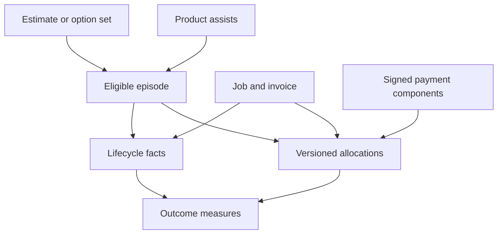

# H03 — Recovery opportunity, lifecycle and outcome contract

Version 1.0.0 · Prepared November 7, 2026 · PAI-H03

This contract makes the first estimate-recovery workflow measurable without confusing activity with customer value. It defines the denominator, separate lifecycle facts, financial links and corrections that the later Codex/Cursor implementation must preserve. It adds no new mission, authority, scheduler, action executor, financial ledger or customer interface.

Read [identity and revision rules](identity-contract.md), [the machine-readable event/interface registry](event-contracts.v1.json), [metric definitions](metric-catalog.v1.json), [financial classification](financial-classification.md) and [permitted exports](export-field-allowlist.v1.json). The rules below are prepared contracts and hand-worked synthetic examples. They are not executed H05 fixtures, live reconciliations, runtime tests or production acceptance.

## 1. Count the eligible opportunity before any recommendation

The unit for estimate recovery is one **canonical eligible episode**, identified before selection. Its canonical target is the existing estimate or company-scoped estimate option set. Three Good/Better/Best rows in one option set do not create three revenue opportunities. A new recommendation, a follow-up, a reminder, an edited proposal or an AI retry does not create another episode.

Current estimates have `tierGroupId`, option-set versions, status and import lineage. Those are useful existing identities. Current revenue proposal generation begins with pending recommendations, excludes snoozed/expired/unsupported candidates, orders by urgency and selects a limited number. Its `eligible` variable and aggregate `skipped` count do not establish a complete pre-decision business population. [Estimate schema](https://github.com/SimonShaun2/Renvani/blob/5e3e83eaaf52caa2b97707fbe67b0fc92f63cd58/packages/db/src/schema.ts) · [Proposal generation](https://github.com/SimonShaun2/Renvani/blob/5e3e83eaaf52caa2b97707fbe67b0fc92f63cd58/apps/api/src/services/revenue-agent/revenue-agent-proposals.service.ts).

C09 must establish a complete eligibility snapshot under the approved rule:

| Required evidence | Meaning |
|---|---|
| `opportunity_id` and canonical target | Stable company-scoped episode identity |
| `eligibility_snapshot_id`, `evaluation_population_ref` | Complete population query/snapshot lineage, not merely the chosen top candidates |
| `eligibility_rule_version`, `eligible_at`, `eligibility_evaluated_at` | The rule, effective qualification time and actual evaluation time |
| `feature_set_version`, `feature_as_of`, internal snapshot reference | Only evidence available before selection; no future outcomes in decision features |
| `selection_state`, registered reason | Selected, unselected or not yet evaluated; distinct from operator approval |
| `maturity_policy_id/version`, start/end | Versioned opportunity outcome window |
| Source origin, import batch and source version | Native/imported/unknown lineage is preserved |
| Source population completeness and observation cutoff | Whether the full declared cohort was actually covered |

The snapshot includes eligible opportunities that are unselected, declined, failed, unanswered, unbooked and still pending. Missing records cannot be replaced with “zero eligible.” Incomplete traversal prevents a complete conversion claim.

Freeze pre-decision features and eligibility when the episode is established. Later selection and outcomes can update analytical projections without rewriting what was known then. A correction is versioned and visible. A second recovery episode for the same target requires an explicit recurrence policy and prior-episode linkage; a repeated scan cannot invent re-entry.

Imported estimates may become eligible for a new post-cutover recovery action. Imported historical jobs/payments remain baseline. Their original collection date or import timestamp must not become a Renvani-caused outcome. An episode's actual new work needs its own native facts and verified links.

That outcome boundary does not discard valid financial history. A backfilled Stripe transaction with authoritative reconciled receipt evidence belongs in its original requested financial posting period under H02. Its later ingestion is not new cash. Imported CRM invoice/estimate face values without collection proof are not receipts. Provenance describes the underlying business fact; backfill is an ingestion route, not a reason to fabricate or erase a historical financial fact.

## 2. Lifecycle is evidence, not one overwritten status

The existing authorized workflow owns business state. Reporting records separate observations and resolves their current meaning. A missing stage is **unknown**, or explicitly **not applicable** under a versioned stage policy; it is never silently assumed to have succeeded.

| Stage | Sufficient evidence for this observation | What it does not prove |
|---|---|---|
| Eligible | Accepted pre-decision population snapshot | Selected or recommended |
| Selected / unselected | Recorded selection decision | Operator approval |
| Proposed | Existing persisted proposal, linked to the opportunity | Approval or execution |
| Approved / declined | Existing operator action decision and audit | Customer response or provider send |
| Execution attempted | A real attempt under existing authority with stable attempt ID | Committed outcome or delivery |
| Queued | Typed outbound receipt says queued | Provider request, acceptance or delivery |
| Internal execution succeeded | Durable internal side effect and succeeded receipt | Customer booking, work completion or payment |
| Execution failed | Actual failed attempt receipt | Permanent business failure if a later authorized attempt succeeds |
| Provider accepted | Verified provider acknowledgement for that request | Delivery |
| Delivered / delivery failed / unknown | Channel-specific verified receipt, or explicit uncertainty | Response or customer outcome |
| Customer responded | Correlated incoming response or customer estimate disposition | Scheduled booking |
| Booked | Authoritative accepted booking/schedule with verified job/opportunity link | Completed work |
| Work completed | Current authoritative completion evidence for the linked job | Collected money |
| Principal collected | Confirmed reconciled service-principal component and allocation | Causal lift or recognized profit |
| Refunded / financially adjusted | Actual signed source component and allocation | Automatic application-fee refund |
| Business cancellation or completion correction | Authoritative distinct reversal/correction evidence | Erasure of the original historical occurrence |

**Source-specific interpretation matters.** In current source, outbound execution deliberately remains `executing` with `outcome=queued` and `deliveryState=queued`. The audit can still be named `agent.execution_succeeded`. The reporting adapter must inspect the typed receipt and execution kind: that combination maps to `workflow.execution_queued`, never to delivery or completed customer value. The code explicitly states that no provider send occurs at this boundary. [Receipt helper](https://github.com/SimonShaun2/Renvani/blob/5e3e83eaaf52caa2b97707fbe67b0fc92f63cd58/apps/api/src/services/agent-action-receipt.ts) · [Execution service](https://github.com/SimonShaun2/Renvani/blob/5e3e83eaaf52caa2b97707fbe67b0fc92f63cd58/apps/api/src/services/agent-action.service.ts).

An operator rejecting a proposal and a customer declining an estimate are different events. `agent.proposal_rejected` supports the former. `estimate.declined` supports a customer response after correlation, with a registered disposition and no raw comment text.

Likewise, current estimate conversion emits `estimate.converted` and `job.created`. It establishes a job link; it does not itself establish a scheduled booking. Current job scheduling and completion emit distinct facts. A `job.reopened` event can currently represent a previously cancelled job returning to another state, so the adapter cannot assume every such event reverses completed work. [Estimate conversion](https://github.com/SimonShaun2/Renvani/blob/5e3e83eaaf52caa2b97707fbe67b0fc92f63cd58/apps/api/src/services/estimate.service.ts) · [Job lifecycle](https://github.com/SimonShaun2/Renvani/blob/5e3e83eaaf52caa2b97707fbe67b0fc92f63cd58/apps/api/src/services/job.service.ts).

Late observations are allowed. A payment can precede work completion, and a delayed delivery receipt can arrive after a response. Store each event's actual occurrence and ingestion times; do not fabricate a chronological chain or advance missing stages.

## 3. Existing sources are signals with explicit limits

| Source | Reuse | Limitation carried to implementation |
|---|---|---|
| `activity_events` | Native event identity, tenant and entity links, occurrence time | No universal opportunity/attempt/release/source-version envelope; payload/summary cannot be exported wholesale |
| `agent_actions` and typed receipts | Proposal/decision/execution meaning and operational idempotency | Current row/latest receipt does not necessarily preserve every real execution attempt |
| Estimate and job services | Authoritative conversion, scheduling and completion transitions | Link each fact to the same company/episode; a created job is not a booking |
| Existing payment and provider boundary | Payment/refund/fee source relationships | Signal names alone do not establish exact principal, signed component, reconciliation or allocation |
| Revenue outcomes summary | Current tenant-scoped period activity and existing UI meaning | Its revenue fallback from paid to invoiced to estimated amount is not reconciled collected cash |
| Langfuse audit/import adapter | Existing instrumentation boundary and some company/action/import context | Action lifecycle trace is not an LLM attempt; current trace keys do not establish full usage, retry, latency or cost coverage |

The existing revenue outcomes summary must keep its current defined meaning until a separately reviewed change. Do not relabel its number as PA-M14. [Current outcome implementation](https://github.com/SimonShaun2/Renvani/blob/5e3e83eaaf52caa2b97707fbe67b0fc92f63cd58/apps/api/src/services/revenue-outcomes.service.ts) · [Langfuse adapter](https://github.com/SimonShaun2/Renvani/blob/5e3e83eaaf52caa2b97707fbe67b0fc92f63cd58/packages/ai/src/langfuse/client.ts).

## 4. Opportunity and financial links

This graph is analytical lineage. It cannot execute any business action.

One job may have multiple assisting products, reminders or proposals. One payment may settle multiple invoices or jobs. A job may receive multiple partial payments and refunds. Directly joining all those relationships and summing the payment amount will multiply money.

Use canonical classified financial postings, then a separately accepted allocation set. Each source component is counted once in company totals. Outcome totals sum only its accepted allocation amounts, never the repeated original amount produced by a many-to-many join.

An accepted financial link requires verified company/environment identity, exact component/currency/basis, referenced source revision and valid target relationships. An unresolved link remains visible as pending/unallocated coverage. It cannot be assigned heuristically to the last recommendation or closest timestamp.

## 5. Signed allocation invariant

For each exact source component `S`, company, currency, exponent, source revision and accepted allocation-set revision:

- There is one explicit remainder row, including when its amount is zero.
- Every nonzero allocated amount and remainder has the same sign as `S`.
- The sum of signed destination allocations plus the signed remainder equals `S` exactly.
- The sum of allocation magnitudes cannot exceed the magnitude of `S`.
- Each allocated row has a validated opportunity, job or invoice destination. The remainder has no destination.
- A nonzero remainder prevents a complete-allocation claim. Different components' remainders cannot cancel to “prove” completeness.
- When `S=0`, every allocation and the remainder must be zero.

`rpt_outcome_allocation_v1` carries `allocation_set_id`, `allocation_set_revision`, `allocation_id`, `allocation_role`, source posting/revision/component, exact `allocated_amount_minor`, currency/exponent, destination links and rule version. Queries select exactly one accepted complete set revision. “Complete set” means every allocation and its remainder are present; `complete_allocation=true` additionally requires zero remainder and complete source/target evidence.

An actual refund creates a negative source component with its own allocations. It does not delete the original collection or automatically refund a platform fee. A mapping/allocation correction replaces the full analytical set with a new version and lineage; it does not post new money. An actual provider reversal or correction has its own signed financial posting.

Use source-proven exact invoice/line links where available. A proportional or other split requires a versioned accepted rule. The existing RCI helper demonstrates deterministic largest-remainder allocation with stable-ID ties for two-decimal money; this does not approve a universal accounting policy. C06/C09 must preserve other currency exponents and micro-cost precision through a compatible reviewed extension. [Existing exact-allocation implementation](https://github.com/SimonShaun2/Renvani/blob/5e3e83eaaf52caa2b97707fbe67b0fc92f63cd58/apps/api/src/services/connected-intelligence/foundation-math.ts).

### Worked allocation example A — USD payment with explicit remainder

All IDs and amounts are synthetic. USD exponent is 2; amounts below are exact integer strings in cents.

| Source component | Active set | Opportunity A | Opportunity B | Unallocated remainder | Check |
|---|---|---:|---:|---:|---|
| P1 service principal `100000` | v1 | `60000` | `35000` | `5000` | 60,000 + 35,000 + 5,000 = 100,000 |
| R1 partial principal refund `-25000` | v1 | `-15000` | `-9000` | `-1000` | -15,000 - 9,000 - 1,000 = -25,000 |

Company net service principal is **75,000 cents / USD 750.00**. Linked net amounts are A **45,000**, B **26,000**, with net unallocated **4,000**. Each source remains partly unallocated; linked reporting cannot claim complete outcome coverage.

An actual platform application fee of **2,000 cents** remains its own component. The principal refund above does not change that fee unless an actual fee-refund/adjustment record exists. It also does not justify substituting 5% or 2% of the payment as the recorded fee.

### Worked allocation example B — correction applies once

New target evidence resolves both remainders:

| Source component | New active set | Opportunity A | Opportunity B | Remainder | Check |
|---|---|---:|---:|---:|---|
| P1 `100000` | v2 supersedes v1 | `60000` | `40000` | `0` | 100,000 |
| R1 `-25000` | v2 supersedes v1 | `-15000` | `-10000` | `0` | -25,000 |

Company net remains **75,000 cents**. Linked A is **45,000**, linked B is **30,000**, with no remainder. Reimporting v2 changes nothing. Including both v1 and v2 would double-count and must be rejected by the current-snapshot query contract. The revision changes attribution completeness; it does not create another collection or refund.

### Worked allocation example C — arithmetic equality alone is insufficient

For refund `S=-25000`, proposed allocations A `-15000`, B `-11000`, remainder `1000` add arithmetically to `-25000`. The set is still **invalid**: the positive remainder has the wrong sign, and the allocated magnitude of 26,000 exceeds the source magnitude of 25,000. A cross-company or different-currency target is invalid even when the arithmetic matches.

For an original positive source, a negative “remainder” cannot conceal over-allocation. Keep sign, magnitude and identity checks in addition to equality.

### Worked allocation example D — currency precision

Under a separately accepted equal-weight rule, a USD `10001`-cent source splits `5001`/`5000` with a stable tie-break and zero remainder. A JPY `1001` source with exponent 0 splits `501`/`500` in yen. These are separate currencies and are never added into one unlabeled total. The current two-decimal helper does not itself prove runtime support for the JPY case.

## 6. Mature cohorts, pending outcomes and activation

PA-M10–M14 and PA-M24 use the declared eligibility cohort and approved maturity policy. In v1, stage windows use the opportunity's `maturity_start_at`/`maturity_end_at`; do not invent additional unversioned windows. Missing policy yields unavailable mature-cohort metrics.

A cutoff can be recent while an outcome is still legitimately pending. Distinguish:

| State | Interpretation |
|---|---|
| Eligible and window open | Pending maturity; retain in the full cohort |
| Mature and complete evidence shows no outcome | Observed non-conversion under the declared window |
| Mature with missing source/link evidence | Unknown outcome/coverage gap; not a verified failure or an excluded inconvenient denominator |
| Outcome source is stale | Affected current claim unavailable or explicitly partial |
| No eligible population | Null/unavailable rate, not 0% conversion |
| All eligible cases covered and none reached the stage | A real observed zero, with denominator and cutoff |

Report observed stage numerators and all required pending/unknown counts. Compare completed mature cohorts on the same rule, time basis and cutoff. Do not compare today's newly eligible opportunities against last month's fully matured outcomes without adjustment. A response/delivery metric denominator must be explicitly named; “of all mature eligible opportunities” and “of delivered messages” answer different questions.

A later refund can change a cohort's net collected amount after the original collection qualified within its window. Retain the original eligible cohort, link the refund to that source component, and label the revised net measure with its newer observation cutoff. The immutable as-published snapshot and the current restated cohort must be distinguishable. H02 owns the precise PA-M14 qualification and later-adjustment rule.

Company activation uses the supporting `company_activation_input_v1` contract. The accepted service-ready time, cohort version, milestone definition, first-value source, opportunity and window policy remain explicit. Later company cancellation stays in the original cohort; removing it would improve retention artificially.

The first proposed value milestone is a verified recovery booking linked to an eligible estimate, subject to Product's accepted definition and actual C10 source coverage. A sent message is insufficient. Time-to-first-value measures only observed activation durations and separately exposes companies still unactivated/right-censored. Repeated value requires a different canonical opportunity reaching the same accepted milestone within the declared repeat window. A retry, reminder or second copy of one booking is not repeat use.

No universal maturity or activation duration is approved in H03. C09/C10 must use the accepted policy; missing source evidence keeps relevant activation/outcome cards unavailable while unrelated financial reporting proceeds.

## 7. Product assistance is non-additive

Suppose one synthetic job, J1, is supported by Revenue recovery, Operations scheduling and Retention follow-up, then completes and collects USD 750.00 net.

- Company completed-job count is **one**.
- Company net collected principal is **USD 750.00**.
- All three products may have an assistance link to J1.
- Product assistance slices overlap; summing three USD 750.00 slices into USD 2,250.00 is invalid.

Preserve existing source product IDs and map presentation labels separately. The current source enum includes operational IDs such as `revenue`, `scheduling`, `service`, `retention`, `owner` and `loyalty`; renaming them for the five current product areas requires a versioned mapping, not a source-ID rewrite.

Association with an assisted job is not proof that Renvani caused the job or increased revenue. No v1 metric claims incremental lift. Later learning/experiment work must obtain its own permitted dataset, evaluation and experiment authority.

## 8. Attempts, failures and AI usage

Count logical actions, actual attempts and unique opportunity outcomes separately. One approved action can have two attempts; the first may fail and the second succeed. The failed attempt remains in failure/cost evidence, while the opportunity can eventually reach a successful stage. Those counts are not disjoint funnel buckets.

For AI, `invocation_id` identifies the logical call and `attempt_id` identifies an actual provider-request attempt, including observed zero-cost or unknown-billing attempts. Failure/usage denominators include all actual attempts, not only those with a confirmed charge. Re-importing an observation from Langfuse to PostHog preserves that identity; it does not add another cost. A real billed retry remains cost, including a failed call. Preserve `provider_reported`, `price_estimated` and `invoice_allocated` cost bases, with only one adopted representation per expense component/period.

Current Langfuse audit IDs use action/lifecycle and import-session keys. They do not prove complete attempt-level instrumentation or model costs. C01/C11 choose and implement one primary trace authority, avoid duplicate ingestion, and preserve unknown coverage. Raw prompts, outputs, tool payloads and provider error text are unnecessary for these contracts and are excluded by H04.

## 9. Replay, correction and withdrawal

A reporting replay consumes existing authoritative source evidence and rebuilds read projections with stable IDs. It never re-approves a proposal, invokes a message provider, books a job, charges a card or retries operational work.

When a fact is corrected, retain its former analytical revision under the permitted retention policy, record the new revision and regenerate affected dependent metrics. When a business event is reversed, retain the original fact and the new authoritative reversal. When access, retention or deletion changes, H04 governs copies, derived aggregates and backfill suppression; retained provenance is not an exception to that policy.

A late refund belongs in its actual posting-period financial view and in the explicitly restated cumulative/cohort net view where defined. It does not silently replace the original published cash-period total. A new allocation revision must not become a new payment.

## 10. H03 evidence and downstream checks

| H03 requirement | Prepared evidence | Runtime consumer / later acceptance |
|---|---|---|
| Stable server/company/provider identity | Identity contract, scoped tuple and I01–I06 examples | C02; AT01/AT09 |
| Versions, timestamps, source and relevant execution references | Common envelope and seven logical interfaces | C03/C07/C09/C10; AT10–AT12 |
| Distinct approval, execution, acknowledgement, delivery and outcomes | 24 normalized event meanings; pinned queued-receipt and estimate-conversion interpretation | C09/C10/C15; AT13–AT15 |
| Idempotency, corrections and signed many-to-one allocation | I07–I10 and worked allocation A–D; explicit set revisions | C07/C08/C09/C15; AT10/AT11/AT16 |
| Non-additive assists and imported baseline | Canonical opportunity/outcome rules and worked J1 example | C09/C15; AT13/AT15/AT16 |
| AI attempt identity and cost representation | Usage contract and attempt/copy distinction | C11/C12; AT17–AT19 |
| Existing RCI/current event compatibility | Inspected source table and identity compatibility matrix | C02/C03 plus RCI-C02; H05 executable fixtures |

The examples are manually specified expected results for review. H05 owns the separate executable fixture matrix; H08 owns review of the complete preparation package. No authenticated access, real provider behavior, deployment, live source coverage, production calculation or independent runtime QA pass is claimed here.

