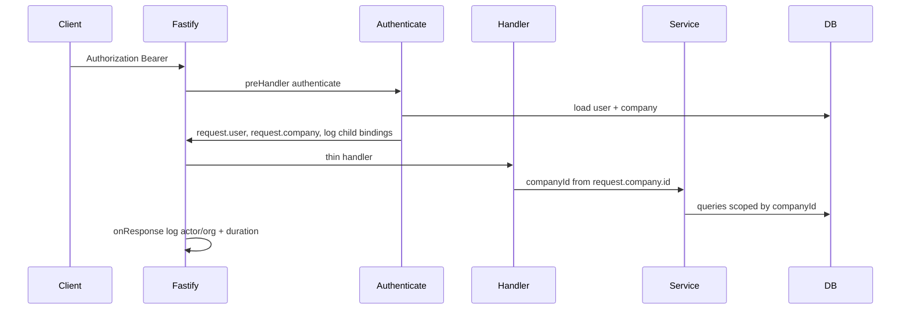

# FS-42 — Auth, membership, and server-derived tenant access audit

**Ticket:** [FS-42](https://app.notion.com/p/3ff317b92d158115911bd268eca38c2c)  
**Depends on:** FS-8 threat model, FS-10 canonical context, FS-84 staff session slice  
**Complements:** [FS-92 synthetic tenant matrix](./FS-92-synthetic-tenant-negative-test-matrix.md), [STACK-03 cross-tenant CI](./STACK-03-cross-tenant-ci-matrix.md)

## Server-derived organization context

| Layer | Mechanism | Notes |
| --- | --- | --- |
| Request entry | `apps/api/src/plugins/authenticate.ts` | JWT or Clerk → DB user + company; role from **DB**, not token alone |
| Actor/org trace | `apps/api/src/lib/request-actor-context.ts` | `getRequestActorOrgContext` + child logger bindings after auth |
| Request completion | `apps/api/src/plugins/request-logger.ts` | Logs `requestId`, `companyId`, `userId`, `role`, `authProvider`, path, status |
| Service calls | Route handlers | Pass `request.company.id` and `request.user.id` — never `request.body.companyId` |
| Scoped writes | `apps/api/src/plugins/company-scoped-write.ts` | `runCompanyScopedTransaction` uses `request.company.id` |

## High-risk surfaces (this slice)

| Surface | Prefix | Role guard | Negative tests |
| --- | --- | --- | --- |
| VIP operator API | `/api/v1/vip/*` | `owner`, `admin` | `fs-42-tenant-access-audit.test.ts`, STACK-03 unauth |
| CSV import API | `/api/v1/imports/*` | `owner`, `admin` | FS-92 list/read, FS-42 role + spoof query |
| Migrate wizard | `/api/v1/migrate/onboarding/*` | `owner`, `admin` | STACK-03 JWT/Clerk matrix, FS-42 cross-tenant GET |

## Client-supplied `companyId`

- **Authorization:** No protected handler uses body/query `companyId` as the tenant scope. Handlers use `request.company.id` from the verified session.
- **Exception (platform only):** `/api/v1/internal/admin/queues/*` accepts `companyId` query for Renavi internal admins (`requireRenaviInternalAdmin`) to filter queue jobs — not a tenant self-service path.

## Workers and webhooks (explicit binding)

| Path | Tenant binding |
| --- | --- |
| BullMQ job payloads | `companyId` required on import/VIP-related jobs (`@fsm/types` fs-migrate contracts) |
| Stripe webhooks | `apps/webhook/` — metadata + idempotent handlers (FS-8); not expanded in this slice |
| Public VIP join | `/api/v1/public/vip/*` — token/slug scoped; separate from staff session |

## Test evidence

- `apps/api/src/routes/security/fs-42-tenant-access-audit.test.ts`
- `apps/api/src/lib/request-actor-context.test.ts`
- Existing: `fs-92-tenant-isolation.test.ts`, `stack03-fs-migrate-tenant-matrix.test.ts`, `fs-11-import.contract.test.ts`

Run: `pnpm --filter @fsm/api test -- src/routes/security/fs-42-tenant-access-audit.test.ts`
